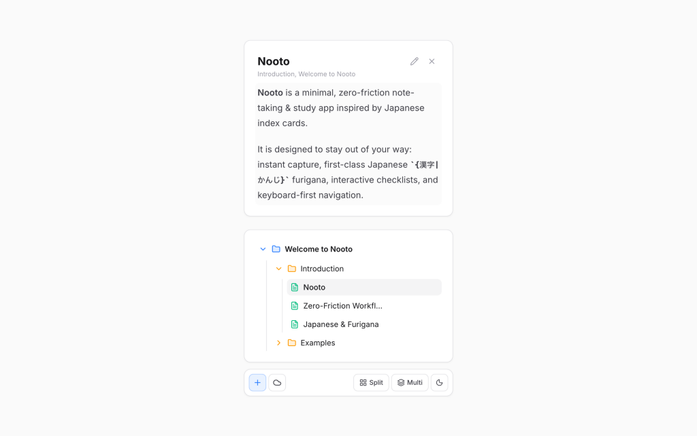

# Nooto

is a minimal note-taking app



I want to keep small notes in a fast, simple and efficient way to study Japanese. Existing solutions are overkill for me, so I wanted to make my own note taking app.

## Features

- **Ultra-Minimal Floating Layout**: Compact side-by-side (or stacked) floating note cards and directory widget with Light & Dark mode.
- **Direct Inline Editing**: Click any note title or content to edit Markdown directly, with automatic local saving.
- **Drag & Drop Organization**: Reorder notebooks, groups, and notes via drag and drop (including moving notes across groups and groups across notebooks) or up/down buttons.
- **Japanese & Furigana Support**: Type `{開|あ}ける` or `{図書館|としょかん}` in Markdown to render `<ruby>` furigana automatically.
- **Interactive Checklists**: Click `- [ ]` task checkboxes directly in rendered notes to toggle them.
- **Keyboard Navigation & Multi Mode**: Flip between notes in a group using `←` / `→`, or enable **Multi** mode to view multiple cards at once.
- **Cloud Sync & JSON Backup**: Edit/copy/export JSON backups or connect a Nooto Cloud API endpoint for push/pull sync.

## TODO

- [x] Refactor code to Svelte 5
- [x] Add cloud-save integration
- [x] Improve Dark Mode
- [x] Add drag-and-drop & keyboard navigation (`←` / `→`)

---
---
---

# sv

Everything you need to build a Svelte project, powered by [`sv`](https://github.com/sveltejs/cli).

## Creating a project

If you're seeing this, you've probably already done this step. Congrats!

```bash
# create a new project in the current directory
npx sv create

# create a new project in my-app
npx sv create my-app
```

## Developing

Once you've created a project and installed dependencies with `npm install` (or `pnpm install` or `yarn`), start a development server:

```bash
npm run dev

# or start the server and open the app in a new browser tab
npm run dev -- --open
```

## Building

To create a production version of your app:

```bash
npm run build
```

You can preview the production build with `npm run preview`.

> To deploy your app, you may need to install an [adapter](https://svelte.dev/docs/kit/adapters) for your target environment.
